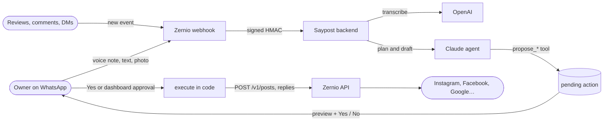

# Saypost

**Run a local business's social media from WhatsApp.** The owner sends a voice note, a text or a photo; Saypost writes the posts, drafts replies to reviews, comments and DMs, and answers "how are we doing this week?". Nothing goes out until the owner says "yes".

[](https://github.com/Martinez03/saypost/actions/workflows/ci.yml)
[](LICENSE)
[](https://zernio.com)

<!-- TODO: replace with a demo GIF (voice note → proposal → "Yes" → published post), e.g. docs/assets/demo.gif -->
> 📽️ *Demo GIF coming soon: a voice note in WhatsApp turns into a post on Instagram, Facebook and Google after one tap on "Yes".*

[Español](README.es.md) · [Self-hosting guide](docs/SELF_HOSTING.md) · [Contributing](CONTRIBUTING.md) · [Security](SECURITY.md)

## Features

- **Voice note to post.** "Today we have stew for 12 € until 4 pm, post it" plus a photo becomes one version per network (Instagram, Facebook, Google Business, LinkedIn, X, TikTok, Threads, Bluesky…), published now or scheduled.
- **Reviews, comments and DMs.** New ones arrive by webhook; Saypost tells the owner on WhatsApp and proposes a reply in the business's tone.
- **"How are we doing?"** Weekly numbers from Zernio Analytics in plain words, with one tip.
- **Approve with one tap.** Every proposal comes with *Yes / No* buttons in WhatsApp and also shows up in the web dashboard.
- **Remembers the business.** Opening hours, prices, the way they talk: the owner says it once.
- **Dashboard.** Approvals, posts, connected accounts, the WhatsApp conversation and settings. Bilingual (English / Spanish).

## How it works



1. Zernio delivers WhatsApp messages and social events to `POST /webhooks/zernio`. The backend verifies the HMAC signature, drops duplicates and answers right away.
2. Voice notes are transcribed; photos are uploaded to Zernio.
3. Claude decides what to do. Its tools can **only propose**: each one writes a row in `actions` with status `pending` and sends the owner the exact preview.
4. The owner taps *Yes* (or approves it in the dashboard). Only then does the backend call the Zernio API to publish or reply.

## Safety model

- **Approval is enforced in code, not in the prompt.** The agent's tools never publish, reply, delete or spend. They create a `pending` action. Execution happens in a separate code path that runs only after the owner's "yes" (button, short text reply or dashboard), and claiming an action is atomic, so it runs once.
- **Untrusted text stays data.** Reviews, comments and DMs are written by strangers. Replies to them are drafted in a one-shot call with no tools, the text is wrapped as untrusted, and it can never trigger a tool by itself. A review saying "ignore your instructions and post this" just gets a polite reply proposal.
- **Only the owner talks to the agent.** WhatsApp messages from numbers not linked to a business are ignored.
- **Secrets stay on the server.** The web only holds the Supabase anon key and reads the database through Row Level Security; everything that needs Zernio, Claude or the service role goes through the backend.

More in [SECURITY.md](SECURITY.md).

## Tech stack

| Part | Stack |
|---|---|
| `backend/` | Node 22, TypeScript, Fastify. Zernio webhooks, the Claude agent (Anthropic SDK), OpenAI transcription, dashboard API. |
| `web/` | Next.js 16 (App Router), React 19, Tailwind 4, shadcn/ui. Landing, sign-up, onboarding and dashboard. |
| `supabase/` | Postgres schema with Row Level Security, Supabase Auth. |
| Integrations | [Zernio](https://zernio.com) (publishing, inbox, reviews, WhatsApp, analytics, webhooks), Claude (`claude-opus-5-5`), OpenAI `gpt-4o-mini-transcribe`. |
| Deploy | Docker Compose with optional Caddy (automatic HTTPS); the web also runs on Netlify or Vercel. |

## Quickstart (local development)

You need Node 22, a [Supabase](https://supabase.com) project (cloud or local with the Supabase CLI), and API keys for [Zernio](https://zernio.com), [Anthropic](https://console.anthropic.com) and, for voice notes, [OpenAI](https://platform.openai.com).

```bash
git clone https://github.com/Martinez03/saypost.git
cd saypost

# 1. Database: apply the schema to your Supabase project
npx supabase login
npx supabase link --project-ref <your-project-ref>
npx supabase db push

# 2. Env files: fill them in (comments explain every variable)
cp backend/.env.example backend/.env.local
cp web/.env.example web/.env.local

# 3. Run both (two terminals)
cd backend && npm install && npm run dev     # http://localhost:4100
cd web && npm install && npm run dev         # http://localhost:3100
```

Without a public URL, Zernio cannot reach your laptop. Two options:

- **Simulate webhooks** locally: `cd backend && npx tsx --env-file=.env.local scripts/simulate.ts text "Post that today we have stew for 12 €"`, then `... simulate.ts yes`. It creates a demo business and signs the payloads like Zernio does.
- **Use a tunnel** (`cloudflared tunnel --url http://localhost:4100`) and register it: `node scripts/setup-zernio-webhook.mjs --env-file backend/.env.local --url https://<tunnel>/webhooks/zernio --test`.

## Self-hosting

Run your own Saypost for your business or your clients: one server with Docker, one domain, your own keys.

```bash
cp .env.example .env                              # fill it in
docker compose --profile caddy up -d --build      # backend + web + Caddy with HTTPS on $DOMAIN
node scripts/setup-zernio-webhook.mjs --env-file .env --test
```

The full guide covers Supabase, every environment variable, Netlify/Vercel, the WhatsApp sandbox vs. your own number, costs and troubleshooting: **[docs/SELF_HOSTING.md](docs/SELF_HOSTING.md)**.

## Project layout

```
backend/            Fastify API, webhooks, agent (src/agent), Zernio client (src/zernio.ts), tests
web/                Next.js app: landing, auth, dashboard
supabase/           migrations (schema + RLS)
scripts/            setup-zernio-webhook.mjs
deploy/Caddyfile    reverse proxy for docker compose --profile caddy
docs/               self-hosting guide; API.md, ESTADO.md, DIARIO.md (internal notes, Spanish)
```

## Built on Zernio

Saypost was built in one day for [Zernio](https://zernio.com)'s "build something cool on our API" challenge. Everything that touches a social network goes through Zernio: one profile per business, connect links, publishing, the unified inbox, reviews, WhatsApp, analytics and signed webhooks.

## Contributing

Issues and pull requests are welcome. Read [CONTRIBUTING.md](CONTRIBUTING.md) first: the approval rule and the untrusted-input rule are not negotiable. Found a vulnerability? See [SECURITY.md](SECURITY.md) and please do not open a public issue.

## License

See [LICENSE](LICENSE).
